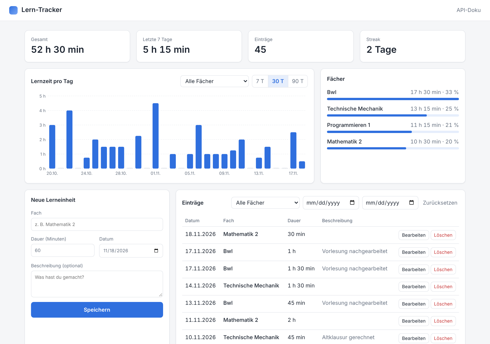
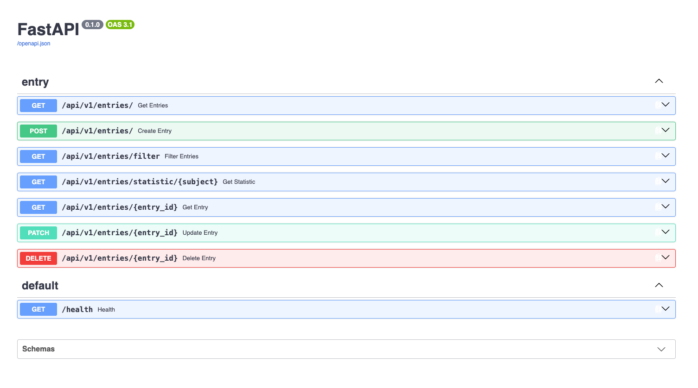

# Lern-Tracker-API


REST-API zum Erfassen und Auswerten von Lerneinheiten. Ein Eintrag besteht aus Fach, optionaler Beschreibung, Dauer und Datum. Die API bietet vollständiges CRUD, Filterung nach Fach und Zeitraum, Statistiken (Übersicht, Streak, Zeitreihe pro Tag) und ein Web-Dashboard, das ausschließlich über die eigene API arbeitet.

Lernprojekt zum Aufbau einer sauberen REST-API mit FastAPI, inklusive Validierung, Testabdeckung, CI und Docker.



## Dashboard

Unter `http://127.0.0.1:8000/` (Weiterleitung auf `/app/`) liegt ein Dashboard aus HTML, CSS und Vanilla-JavaScript, ohne Framework und ohne Build-Schritt:

- Kennzahlen: Gesamtzeit, letzte 7 Tage, Anzahl Einträge, aktuelle Lern-Streak
- Balkendiagramm Lernzeit pro Tag (7, 30 oder 90 Tage, optional pro Fach), als SVG selbst gezeichnet
- Verteilung der Lernzeit auf die Fächer
- Einträge anlegen, bearbeiten und löschen, Validierungsfehler der API werden direkt im Formular angezeigt
- Tabelle mit Filter nach Fach und Zeitraum
- Hell- und Dunkelmodus nach Systemeinstellung

Das Dashboard ist bewusst ein reiner API-Client: Jede Aktion läuft über dieselben Endpunkte, die auch in der Swagger-Doku stehen.



Tech-Stack

| Bereich    | Technologie                  |
| ---------- | ---------------------------- |
| Framework  | FastAPI 0.139                |
| ORM/Models | SQLModel, Pydantic v2        |
| Datenbank  | SQLite (per `DATABASE_URL` austauschbar) |
| Frontend   | HTML, CSS, Vanilla JS (ES Modules) |
| Server     | Uvicorn                      |
| Tests      | pytest, Starlette TestClient |
| CI         | GitHub Actions (Tests + Docker-Build mit Health-Check) |
| Container  | Docker                       |

## Quickstart

```bash
git clone https://github.com/florianwiet/study-tracker-api
cd study-tracker-api

python -m venv .venv
source .venv/bin/activate        # Windows: .venv\Scripts\activate

pip install -r requirements.txt
uvicorn main:app --reload
```

Die Datenbankdatei `entries.db` wird beim ersten Start automatisch angelegt.

- Dashboard: `http://127.0.0.1:8000/`
- API: `http://127.0.0.1:8000/api/v1`
- Interaktive Dokumentation (Swagger): `http://127.0.0.1:8000/docs`
- OpenAPI-Schema: `http://127.0.0.1:8000/openapi.json`

### Mit Docker

```bash
docker build -t study-tracker-api .
docker run -p 8000:8000 -v lern-tracker-data:/data study-tracker-api
```

Die SQLite-Datei liegt im Volume `lern-tracker-data` und überlebt Neustarts des Containers.

### Konfiguration

| Variable       | Default                  | Bedeutung                                  |
| -------------- | ------------------------ | ------------------------------------------ |
| `DATABASE_URL` | `sqlite:///./entries.db` | SQLAlchemy-URL, z. B. für PostgreSQL        |
| `SQL_ECHO`     | `false`                  | SQL-Statements in der Konsole ausgeben     |

Siehe `.env.example`.

## Beispiel

Eintrag anlegen:

```bash
curl -X POST http://127.0.0.1:8000/api/v1/entries/ \
  -H "Content-Type: application/json" \
  -d '{
        "subject": "  Mathematik 2  ",
        "description": "Kapitel 3, Integralrechnung",
        "duration_in_minutes": 90,
        "date": "2026-09-05"
      }'
```

Antwort (`201 Created`):

```json
{
  "id": "8f14e45f-ceea-467a-9c2d-3b1c1f2a77e0",
  "subject": "mathematik 2",
  "description": "Kapitel 3, Integralrechnung",
  "duration_in_minutes": 90,
  "date": "2026-09-05",
  "created_on": "2026-09-05T14:22:31.884210Z"
}
```

Das Fach wird dabei normalisiert: überflüssige Leerzeichen werden zusammengefasst und die Schreibweise vereinheitlicht. `"  Mathematik 2  "` und `"MATHEMATIK 2"` landen also im selben Fach und in derselben Statistik.

Statistik abrufen:

```bash
curl http://127.0.0.1:8000/api/v1/entries/statistic/mathematik%202
```

```json
{
  "subject": "mathematik 2",
  "count": 4,
  "total_minutes": 315
}
```

## Endpunkte

Basis-Pfad: `/api/v1/entries`

| Methode | Pfad            | Beschreibung                    | Status          |
| ------- | --------------- | ------------------------------- | --------------- |
| POST    | `/`           | Neuen Lerneintrag anlegen       | 201 / 422       |
| GET     | `/?limit=&offset=` | Einträge abrufen, neueste zuerst, paginiert (Default 100, max. 500) | 200 / 422 |
| GET     | `/subjects`   | Alle vorhandenen Fächer, alphabetisch | 200       |
| GET     | `/{entry_id}` | Einzelnen Eintrag abrufen       | 200 / 404       |
| PATCH   | `/{entry_id}` | Eintrag teilweise aktualisieren | 200 / 404 / 422 |
| DELETE  | `/{entry_id}` | Eintrag löschen                | 200 / 404       |

### Filter und Auswertung

| Methode | Pfad                                       | Beschreibung                                  | Status          |
| ------- | ------------------------------------------ | --------------------------------------------- | --------------- |
| GET     | `/filter?subject=&start_date=&end_date=` | Einträge nach Fach und/oder Zeitraum filtern | 200 / 400 / 422 |
| GET     | `/statistic/{subject}`                   | Anzahl und Gesamtminuten pro Fach             | 200 / 404       |

Basis-Pfad `/api/v1/stats`:

| Methode | Pfad                       | Beschreibung                                                                 | Status    |
| ------- | -------------------------- | ---------------------------------------------------------------------------- | --------- |
| GET     | `/overview`              | Gesamtzahl, Gesamtminuten, letzte 7 Tage, Streak, Minuten pro Fach           | 200       |
| GET     | `/daily?days=&subject=`  | Minuten pro Tag für die letzten `days` Tage (1 bis 365), Lücken mit 0 gefüllt | 200 / 422 |

Die Aggregationen laufen in SQL (`COUNT`, `SUM`, `GROUP BY`), nicht in Python über alle Zeilen. Die Streak zählt aufeinanderfolgende Tage mit mindestens einem Eintrag bis heute. Gibt es heute noch keinen Eintrag, zählt sie bis gestern, damit sie nicht morgens auf 0 fällt.

Alle Filterparameter sind optional und kombinierbar. Ohne Parameter werden alle Einträge zurückgegeben. Ist `start_date` größer als `end_date`, antwortet die API mit `400`.

### Sonstiges

| Methode | Pfad        | Beschreibung | Status |
| ------- | ----------- | ------------ | ------ |
| GET     | `/health` | Health-Check | 200    |

Jede Antwort enthält zusätzlich den Header `X-Process-Time` mit der serverseitigen Bearbeitungszeit, zum Beispiel `0.0021s`.

## Datenmodell und Validierung

| Feld                    | Typ            | Regel                                         |
| ----------------------- | -------------- | --------------------------------------------- |
| `id`                  | String (UUID)  | wird serverseitig erzeugt                     |
| `subject`             | String         | 1 bis 50 Zeichen, Pflichtfeld                 |
| `description`         | String         | optional, 4 bis 1000 Zeichen                  |
| `duration_in_minutes` | Integer        | 1 bis 600                                     |
| `date`                | Date           | Pflichtfeld, darf nicht in der Zukunft liegen |
| `created_on`          | Datetime (UTC) | wird serverseitig gesetzt                     |

Zusätzliche Regeln:

- `subject` wird normalisiert (Leerzeichen zusammengefasst, einheitliche Kleinschreibung). Ein Fach, das nur aus Leerzeichen besteht, wird abgelehnt.
- `PATCH` aktualisiert ausschließlich die im Request enthaltenen Felder. Nicht mitgesendete Felder bleiben unverändert.
- Verstöße gegen die Feldregeln beantwortet FastAPI mit `422` und einer Detailmeldung pro betroffenem Feld.

## Tests

45 Tests decken alle Endpunkte ab, inklusive Fehlerfälle.

```bash
pip install -r requirements-dev.txt
pytest -v
```

Teststrategie:

- Jeder Test läuft gegen eine frische In-Memory-SQLite-Datenbank (`StaticPool`), die produktive `entries.db` wird nie berührt.
- Die Session-Dependency wird über `app.dependency_overrides` ausgetauscht, die Engine zusätzlich per `monkeypatch` ersetzt.
- Abgedeckt sind: CRUD-Happy-Paths, 404 bei unbekannter ID für GET, PATCH und DELETE, alle Validierungsgrenzen (Dauer 0 und über 600, Beschreibung zu kurz, Fach zu lang, leeres Fach, fehlendes Pflichtfeld, Datum in der Zukunft), Fach-Normalisierung bei POST und PATCH, alle Filterkombinationen inklusive ungültigem Zeitraum und ungültigem Datumsformat, Statistik mit und ohne Treffer, Übersicht und Zeitreihe inklusive leerer Datenbank und Lücken, Streak-Logik als Unit-Test, Pagination und Sortierung, Health-Check und der `X-Process-Time`-Header.

Die Tests laufen bei jedem Push auf `main` und bei jedem Pull Request über GitHub Actions. Danach baut die Pipeline das Docker-Image, startet den Container und prüft `/health`.

## Projektstruktur

```
main.py                    App-Instanz, Timing-Middleware, Lifespan, Health-Endpunkt, Dashboard-Mount
routes.py                  Endpunkte unter /api/v1/entries
stats.py                   Endpunkte unter /api/v1/stats, Streak-Berechnung
schemas.py                 SQLModel-Tabelle, Create-/Update-Modelle, Validatoren
db.py                      Engine (aus DATABASE_URL), Tabellenerzeugung, Session-Dependency
static/                    Dashboard (index.html, styles.css, app.js)
conftest.py                leer, setzt den Projektroot auf den Importpfad von pytest
tests/conftest.py          Fixtures fuer Test-Engine und TestClient
tests/routes_test.py       Tests für CRUD, Filter, Validierung
tests/stats_test.py        Tests für Statistik, Pagination, Streak
Dockerfile                 Container-Image
.github/workflows/ci.yml   CI-Pipeline
```

## Bekannte Einschränkungen

- Keine Authentifizierung und keine Nutzertrennung. Alle Einträge sind global sichtbar.
- `/filter` ist nicht paginiert.
- Kein Migrationstool (z. B. Alembic). Schemaänderungen erfordern bei bestehender Datenbank manuelle Anpassung.
- Ein PostgreSQL-Treiber ist nicht in `requirements.txt` enthalten und müsste ergänzt werden.
- Kein Deployment vorgesehen. Das Projekt ist als lokal lauffähige Referenzimplementierung gedacht.

## Lizenz

MIT, siehe [LICENSE](LICENSE).
